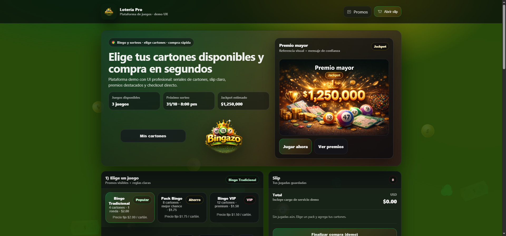

# Sitio de lotería · Prototipo UX/UI

**Diseño y desarrollo: Xioleni Salazar** · [Portafolio](https://xioleni.com/)

[Abrir la demo](https://xioleni.com/proyectos/plataforma-loterias/)

## Descripción del proyecto

Prototipo responsive de una plataforma de venta de juegos de azar, con selección de números, promociones y un slip de compra demostrativo. La interfaz simula el recorrido para explorar juegos, preparar varias jugadas y revisar el ticket antes de continuar.

## Ficha del proyecto

- **Tipo:** plataforma de venta de demostración con selección de números.
- **Código:** HTML · CSS · JavaScript.
- **Dificultad:** Media–alta.
- **Enfoque:** transmitir confianza, explicar el juego con claridad y facilitar la selección de números y la revisión del ticket.

## Qué incluye

- Selección de juegos y picking de números.
- Promociones y premios destacados de muestra.
- Slip de compra con varias jugadas.
- Persistencia del ticket de demostración mediante `localStorage`.
- Layout adaptable para escritorio y dispositivos móviles.

## Alcance de la demo

Es un prototipo de interfaz: los juegos, premios, promociones y métodos de pago son ejemplos. No acepta apuestas, no procesa pagos ni crea compras reales. Los videos testimoniales del sitio original no forman parte de esta copia pública.

## Ejecutar localmente

Sirve la carpeta con `py -m http.server 8000` y abre `http://localhost:8000`.

## Créditos

Diseño e implementación de **Xioleni Salazar**.

## Presentaci&oacute;n r&aacute;pida

Prototipo UX/UI de una plataforma de loter&iacute;a con selecci&oacute;n de n&uacute;meros y flujo de ticket de demostraci&oacute;n.

**Demo:** consulta el enlace indicado arriba. **C&oacute;digo:** abre este repositorio. Las capturas muestran el proyecto local tal como est&aacute; en este c&oacute;digo.

## Decisiones y validaci&oacute;n manual

Recorre la selecci&oacute;n, revisa el resumen del ticket y los estados de interfaz en distintos anchos de pantalla. No acepta apuestas ni procesa pagos reales.

Este repositorio no incluye una suite de pruebas automatizadas. La lista anterior sirve como comprobaci&oacute;n manual de la demo; no se presenta como un resultado de pruebas autom&aacute;ticas.

## Aporte y alcance

Dise&ntilde;o e implementaci&oacute;n de portafolio por Xioleni Salazar. El proyecto demuestra decisiones de interfaz y comportamiento frontend en una demo; no representa una tienda en producci&oacute;n ni trabajo para un cliente.
